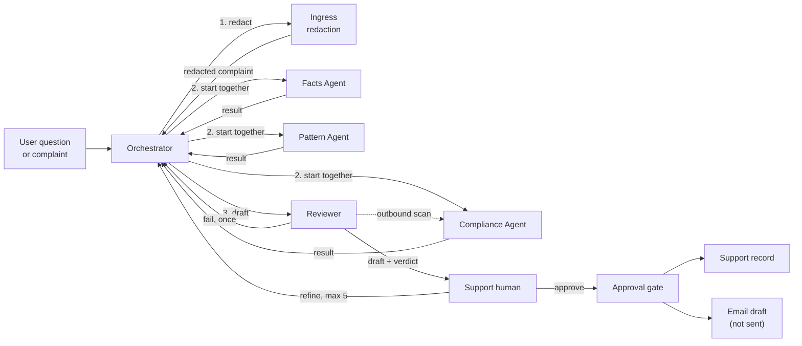
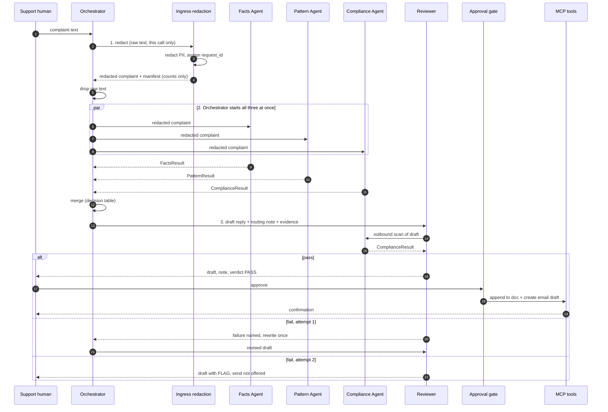
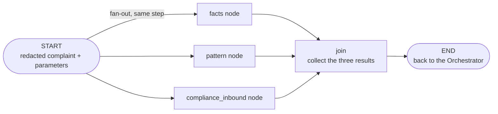
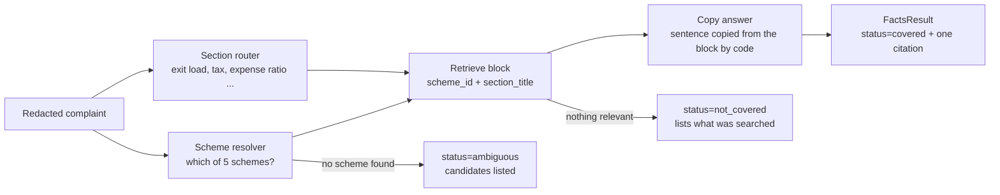
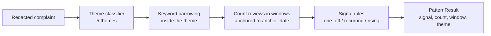
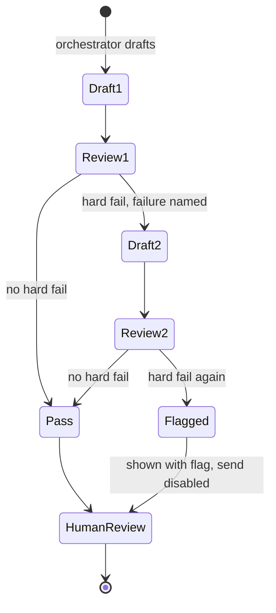
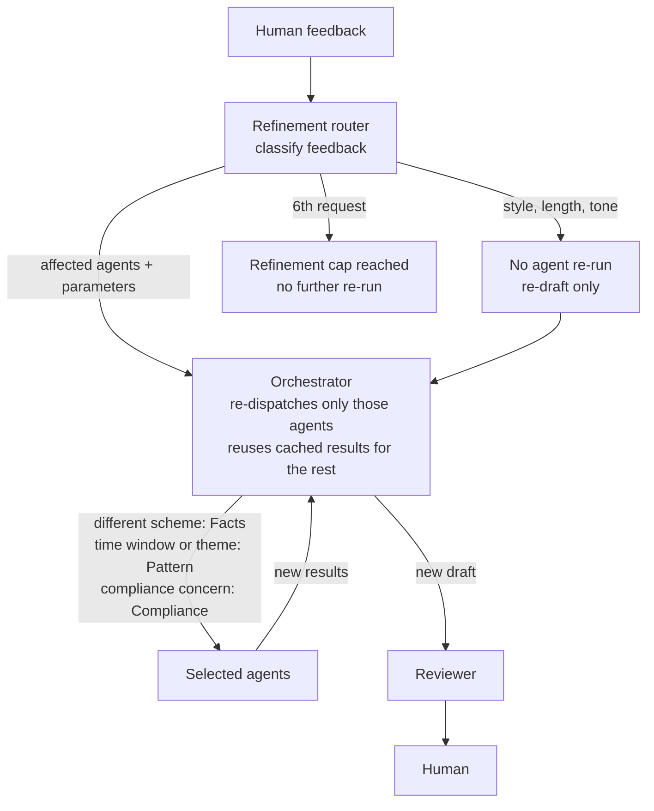
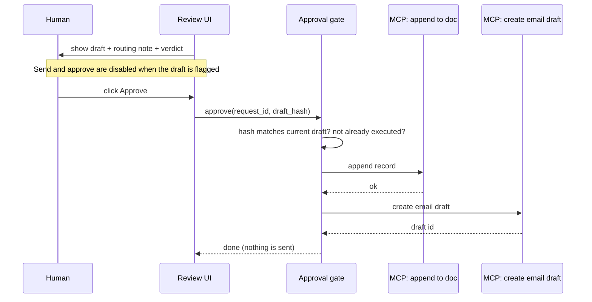

# Architecture: Multi-Agent Support Reply System for GROWW

This document describes how the system in [problemStatement.md](problemStatement.md) is built.

- **Stated requirements** come from the problem statement.
- **Design choices** are marked as such. They fill gaps the problem statement leaves open, such as thresholds, team names, schemas and module layout. They can be changed without breaking a stated requirement.

---

## 1. Goals and constraints

The system takes one user complaint or question and produces:

1. a **reply draft** of three sentences or fewer, facts-only, with one citation link and a "last checked" date
2. an **internal routing note** giving the team and priority

A human must approve before anything leaves the system.

| # | Constraint (from the problem statement) | Architectural consequence |
|---|---|---|
| C1 | Facts-only: no advice, no buy or sell language, no return or performance figures. | The Compliance Agent and the Reviewer both enforce it, at different points. |
| C2 | Every factual claim carries one citation link. No link means it doesn't ship. | The Facts Agent returns a citation with every answer. The Reviewer checks for it with a deterministic rule. |
| C3 | No PII stored anywhere, including logs and agent state. | The Orchestrator's first step is a call to Ingress redaction. The raw text exists only in that function's local scope, and never reaches an agent, a model prompt, state or a log. Logs use an allow-list schema. |
| C4 | Public sources only, same corpus as Milestone 1. | The Facts Agent reads only `data/parsed/`. It has no general-knowledge fallback. |
| C5 | Three agents run in parallel and none reads another's output. | The three agents are three nodes on one LangGraph, started together by a single fan-out from the Orchestrator. Each node passes its agent only the redacted complaint and its own parameters, and results return only to the Orchestrator's join step (Section 4). |
| C6 | Reviewer rework is capped at one round. Refinement is capped at five. | Two counters in the session state machine. |
| C7 | Replies are three sentences or fewer with a "last checked" date. | A deterministic check in the Reviewer. |
| C8 | Nothing moves without a human clicking approve. No auto-send. | An approval gate sits in front of the MCP tools. |

---

## 2. System overview

The Orchestrator sits in the middle. Everything else is a step it starts, or a person who reacts to its output.



**Reading the diagram.**

- **Step 1, redact.** The Orchestrator's first act is to send the raw complaint to Ingress redaction and take back the redacted complaint. Nothing else sees the raw text.
- **Step 2, start together.** The Orchestrator runs one LangGraph whose three nodes are Facts, Pattern and Compliance (inbound). The graph starts all three at the same time and the Orchestrator gets one result back from each. The agents never talk to each other. Each agent makes its own model call, and that call only classifies (Section 6).
- **Step 3, draft.** The Orchestrator merges the results, writes the reply and routing note, and sends them to the Reviewer. On a hard fail the draft returns to the Orchestrator once. The dotted line is the Reviewer's own outbound Compliance scan of the draft.
- **Support human.** The human sees the draft and the verdict. They can send it back with feedback up to 5 times, and the Orchestrator re-runs only the affected agents. Or they approve it. A draft the Reviewer flagged cannot be approved.
- **Approval gate.** After approval only, the gate appends the support record and creates the email draft. It never sends.

### Stores and who reads them

| Store | Role | Who reads it |
|---|---|---|
| `data/parsed/*.json` plus `parse_manifest.json` | Milestone 1 corpus. Five HDFC schemes with seven sections each. `source_url` is the only legal citation. | Facts Agent |
| `data/analyzed_themes.json` | Milestone 2 themes: `allThemes` and `topThemes`. | Pattern Agent |
| `data/normalized_reviews.json` | 1,650 reviews from 2026-04-12 to 2026-07-04. Used to count a theme's reviews inside time windows. | Pattern Agent |
| Session state (memory only) | The redacted complaint, agent results, draft, routing note and counters. No raw text. | Orchestrator, Reviewer |
| Allow-list logs | Agent names, statuses and error codes. No free text. | Engineers, demo trace |
| Approved record (doc and email draft, through MCP) | Written only after the human approves. | Support team |

### Component summary

| Component | Type | Reads | Produces |
|---|---|---|---|
| Ingress redaction | Deterministic code, called by the Orchestrator as its first step | Raw message | Redacted complaint, redaction manifest, request ID |
| Facts Agent | LangGraph node. One model call classifies the section. Code finds the block and copies the sentence. | The redacted complaint and `data/parsed/*.json` only | `FactsResult` |
| Pattern Agent | LangGraph node. One model call classifies the theme. Code counts the reviews. | The redacted complaint, `analyzed_themes.json` and `normalized_reviews.json` only | `PatternResult` |
| Compliance Agent | LangGraph node. Rules and PII detectors are code. One model call classifies advice. | The redacted complaint only. In outbound mode, the draft, when the Reviewer calls it. | `ComplianceResult` |
| Orchestrator | Two parts. Redaction call, the LangGraph run (dispatch and join) and merge are deterministic code. Drafting is a model. | The raw message (in the redaction step only), then the redacted complaint and the three results | Redaction call, agent calls, `Disposition`, `ReplyDraft`, `RoutingNote`, and the call to the Reviewer |
| Reviewer | Deterministic checks, plus an outbound Compliance call | Draft and evidence | `ReviewVerdict` |
| Refinement router | Classifier | Human feedback | The set of agents to re-run |
| Approval gate and MCP client | Deterministic code | Approved draft | Doc append, email draft |

**Principle: put rules in code and language in models.** These checks are code, not prompts: PII regexes, the sentence count, citation presence, the disposition matrix, the counters and the approval gate. Models handle only the parts that need language understanding. Each specialist makes its own model call, and that call only classifies: the section for Facts, the theme for Pattern, and advice or not for Compliance. A specialist's model never writes text that ships. The one model that writes is the Orchestrator's drafter, which can only restate `FactsResult.answer`.

---

## 3. Data layer

All paths are relative to the project root.

```
data/
├── normalized_reviews.json   # 1,650 Play Store reviews (2026-04-12 to 2026-07-04)
├── analyzed_themes.json      # 5 themes; reviewIds join to normalized_reviews.id
└── parsed/
    ├── parse_manifest.json
    ├── large_cap.json  mid_cap.json  small_cap.json
    └── gold_fof.json   silver_fof.json
```

Startup loads three read-only in-memory structures:

| Structure | Built from | Shape |
|---|---|---|
| `Scheme index` | `parsed/*.json` | `scheme_id → {name, source_url, fetched_at, nav_date, sections{section_title → text}}`. That is 5 schemes with 7 sections each. |
| `Review index` | `normalized_reviews.json` | `review_id → {text, rating, date, version}`, plus `anchor_date = max(date)` |
| `Theme index` | `analyzed_themes.json` + Review index | `theme_id → {name, review_ids[], dated_reviews[]}`, joined once at startup |

- **`anchor_date`.** Time windows are measured back from the newest review, currently 2026-07-04, and not from the wall clock. The data is a fixed snapshot, so "this week" measured from today would be empty.
- **Corpus freshness.** `fetched_at` and `nav_date` in each scheme file feed the "last checked" date. They are not today's date.
- **Read-only.** No agent writes to `data/`.

---

## 4. Request lifecycle



**Who triggers whom.** The Orchestrator is the single owner of control flow. It calls Ingress redaction first, then triggers the three agents, collects their results, merges them, writes the draft, and sends the draft to the Reviewer. A hard fail returns to the Orchestrator for the one allowed rework. Refinement also goes through the Orchestrator, which re-dispatches only the affected agents.

**Parallelism.** The three agents are three nodes on **one LangGraph**, started together. The graph is fixed code, not a model-chosen route, so the model never decides in turn which agent to ask and the three really do run at the same time.



How the graph keeps the rules:

- **Fixed shape.** One start step fans out to the three nodes, and one join step waits for all three. The edges are set in code. There is no router node and no model choosing a path.
- **Same snapshot.** The three nodes run in the same step, so each reads the same state from before the step. None can see another's output, because nothing is written until the step ends. Each node also passes its agent only the redacted complaint and that agent's own parameters (`scheme_override`, `theme_hint`, `window`), never the whole state.
- **One result slot each.** Each node writes only its own key (`facts`, `pattern` or `compliance_inbound`), so the nodes never write to the same field.
- **Timeouts and failures.** Each node runs its agent under a per-agent timeout. A timeout, an exception or an invalid result becomes `status = "error"` in that node's slot. A node never raises into the graph, so a failed branch can't cancel the other two.
- **Which nodes run.** The entry step starts a chosen subset of the three nodes, so a refinement can re-run only the affected agents with the cached results left in state (Section 10). A first run starts all three.
- **No persistence.** The graph runs with no checkpointer and no external tracing. Graph state holds only the redacted complaint, parameters and results, and it is dropped when the run ends (C3).
- **Timestamps.** Each node records its own start and end time, so the trace can show the three starts overlap.

The three results meet for the first time at the join step, and the Orchestrator's merge runs after the graph returns. The Orchestrator never passes one agent's result to another.

**Orchestrator, Reviewer and Compliance.** The Orchestrator does not review its own draft. The Reviewer is separate. It returns only a pass or a fail with a named reason, and it calls the Compliance Agent in outbound mode. The Orchestrator is not involved in that call.

**Failure of a branch.** If an agent errors or times out, it returns `status = "error"` with a reason. The Orchestrator then produces no reply draft. The result is `HOLD_AGENT_FAILURE` with a routing note saying which agent failed. A missing agent is never filled in with a guess.

---

## 5. Ingress redaction and PII handling

The problem statement says PII is redacted **before anything is stored**, and also says agents run in parallel with no shared output. Both hold if redaction is a deterministic step that the Orchestrator calls **first**, before it starts any agent. It is not an agent and not a model.

The raw complaint therefore reaches the Orchestrator, but only its deterministic dispatch code, and only for the length of that one call. Redaction finishes **before the LangGraph is started**, so the raw text is never an input to the graph, never part of graph state and never visible to a node. The Orchestrator's drafting model, the three agents (and their classifier calls), the graph state, the session state and the logs only ever receive the redacted complaint.

| Step | Detail |
|---|---|
| Detect | Regex and checksum rules for the 6 PII types below. |
| Replace | Each match becomes a typed placeholder such as `[PAN]`, `[PHONE]`, `[EMAIL]`, `[AADHAAR]`, `[ACCOUNT_NO]` or `[OTP]`. |
| Manifest | Records only `{type, count}`. It never records the value or its position in a way that lets the value be rebuilt. |
| Scope | The raw text lives only in a local variable of the Orchestrator's dispatch code and in the redaction function. It is not passed on, logged, put in any state object (including the LangGraph state) or included in any model prompt. Both references go out of scope when the redacted complaint is returned. |

| PII type | Detection sketch (design choice) |
|---|---|
| PAN | `[A-Z]{5}[0-9]{4}[A-Z]` |
| Aadhaar | 12 digits, optionally grouped 4-4-4, with a Verhoeff checksum where possible |
| Phone | Indian mobile: optional `+91` or `0`, then 10 digits starting 6 to 9 |
| Email | Standard email pattern |
| OTP | 4 to 8 digit code near words such as "otp", "code" or "pin" |
| Account number | 9 to 18 digits near "account", "a/c" or "acct" |

Where the rules are ambiguous, redact. False positives are cheap and leaks are not.

**Defence in depth.** PII is checked in three places, so one miss doesn't leak:

1. **Ingress redaction**, deterministic, called by the Orchestrator before it starts any agent.
2. **Compliance Agent inbound scan**, which re-scans the redacted complaint and flags any residual PII.
3. **Reviewer**, which re-scans the outgoing draft. This is the hard-fail check.

**Refinement and the raw text.** A refinement never needs the raw complaint. The Orchestrator re-dispatches using the redacted complaint kept in state, so redaction runs once per ticket.

**Consequence for data.** The review file contains no PII strings. PII test cases are therefore built by taking a real review and inserting a fake value. Ingress redaction must catch that.

---

## 6. The three parallel agents

**Each specialist gets its own model call, and the model only classifies.** Code does the rest.

| Agent | What the model classifies | What code does |
|---|---|---|
| Facts | Which of the 7 sections the question is about | Resolves the scheme, looks up the block, and **copies the sentence** from the scheme file |
| Pattern | Which of the 5 themes the complaint belongs to | **Counts the reviews** in the windows and applies the signal rules |
| Compliance | Whether the text asks for or gives advice or a performance claim | Runs the phrase rules and the **PII detectors** (the same ones Ingress uses to redact) |

The three calls are three nodes on one LangGraph, started together (Section 4). Each model returns one label from a fixed list. For Facts and Pattern, anything else is treated as "no label" and the code path decides. For Compliance, anything else gives an `error` result, never a clean one (Section 13). A label can only make a result stricter or fall back to the code path. No specialist's model writes the text a customer reads, and none can add a fact, a number or a link.

### 6.1 Facts Agent

**Job.** Answer from the scheme corpus with one citation, or say it can't.



| Step | Behaviour |
|---|---|
| Scheme resolution | Match the message against the 5 scheme names and aliases (for example "large cap", "gold fund", "silver FoF"). If no scheme is named, return `ambiguous` with the candidate list. Do not guess. |
| Section routing | Map intent to one of the 7 sections. A keyword map handles the common cases. This agent's model call handles the rest, and it only returns a section title or nothing. |
| Retrieval | Look up `sections[section_title]` directly. There are only 35 blocks (5 schemes × 7 sections), so no vector store is needed. |
| Extraction | Code copies the relevant sentence or sentences from the retrieved block. No model writes or rephrases the answer, so every word and number in `answer` comes from the scheme file. The one exception is a fixed template for fund managers ("is managed by", "and"), because that block is long, noisy text that must not be copied whole. |
| Citation | The scheme's `source_url`. The output holds exactly one link. |
| Not covered | `status = "not_covered"`, with `searched = [scheme_ids, section_titles]`. There is no fallback to general knowledge (C4). |

Behaviours that follow from the corpus contents:

- **Returns.** The corpus has no returns, CAGR, ranking or rating data. A returns question is always `not_covered`.
- **Ambiguous exit load.** "Exit load" with no scheme named is ambiguous. The window differs (1 year for the three equity funds, 15 days for Gold and Silver), so Facts asks for the scheme instead of answering.
- **Riskometer.** It can be quoted as a fact, with a citation. It can never be used to say a scheme is good or bad.
- **Fund management text.** It is noisy. Only manager names and tenure are used, never the text verbatim.
- **App issues.** Bugs, KYC status and payments are `not_covered`. These are the majority of real complaints, so many runs correctly end with a "not covered" answer.

### 6.2 Pattern Agent

**Job.** Say whether the complaint is recurring, rising or a one-off, with the count and the window.



| Step | Behaviour |
|---|---|
| Theme classification | Assign one of `trading_charts`, `money_movement`, `reliability`, `fees_brokerage` or `other`. A keyword and word-count classifier handles the common cases. This agent's model call handles the rest, using the theme descriptions, and it only returns one of the five theme IDs or nothing. Counting is always code. |
| Keyword narrowing | The themes are broad. For example, only 2 reviews mention "exit load". The agent extracts key terms from the complaint and counts reviews in the theme that contain them. If nothing matches, it falls back to the theme-level count and says so. |
| Windows | Current window: the 7 days ending on `anchor_date`. Prior window: the 7 days before that. Longer context: the full 84-day span. |
| Signal | See the rules below. |

**Signal rules (design choice, thresholds are configurable).**

| Signal | Rule |
|---|---|
| `rising` | `count_current ≥ MIN_COUNT` and `count_current ≥ 1.5 × count_prior` |
| `recurring` | Not rising, `count_current ≥ MIN_COUNT`, or matches present in at least 3 of the last 4 weekly windows |
| `one_off` | Everything else |

**Theme-level results are capped.** When keyword narrowing finds nothing (`basis = "theme_level"`), the count is the whole theme's volume, which says little about *this* complaint. Such a result can be `recurring` but never `rising`, and the catch-all theme `other` is always `one_off`. Only a keyword match can raise `rising`, so a surge in a broad theme can't hold an unrelated ticket (found in Phase 3: without the cap, ordinary scheme questions classified as `money_movement` came back `rising` and would have been held).

`MIN_COUNT` defaults to 5 and should be tuned on the data. Phase 3 kept 5, because all three signals occur at that value (see the tuning note in `config/settings.toml`). Windows are weekly because the statement's examples use "this week" and "last week".

**Output always includes** the theme, the count of reviews behind the signal, the window used, and whether the count came from keyword narrowing or from the whole theme. A user asking for "the fee issue from last week" is answered by re-running this agent with a shifted window.

**Return only counts and review IDs, not review text.** This keeps the text of past reviews, which might contain PII, out of agent state.

### 6.3 Compliance Agent

**Job.** Flag advice language, performance or return claims, and PII. It works in two modes, and both use the same rules.

| Mode | When it runs | Input | Purpose |
|---|---|---|---|
| **Inbound** | In the parallel dispatch, started by the Orchestrator | Redacted complaint only | Detect advice-seeking, return-seeking and any residual PII |
| **Outbound** | Called by the Reviewer on each draft | The draft | Detect advice language, performance or return claims and PII in the draft |

Because the draft doesn't exist during the parallel dispatch, the outbound scan can't happen there. It happens when the Reviewer calls the Compliance Agent on each draft. The problem statement's phrase "scans the incoming message and the outgoing draft" is met this way.

**Detection layers:**

1. **Rule layer (deterministic).** Phrase lists and patterns for buy, sell, redeem, hold, "should I", "good fund", "best", "consider staying invested", "will give", "expected returns", percentages next to words like "returns", "growth" or "CAGR", and forward-looking wording.
2. **Classifier layer (this agent's model call).** Catches paraphrases the phrase lists miss. It only labels the text `advice_request`, `advice_in_text`, `performance_claim` or `none`. It can add a flag but never remove one, and a failed call or an unknown label gives an `error` result, never a clean one.
3. **PII layer (code).** The same detectors as Ingress redaction, which does the redacting. Here they only find and count what survived. For the outbound draft, any hit is a hard fail.

**Statistics vs. performance.** Expense ratio, exit load, AUM and NAV are corpus facts and are allowed with a citation. Returns and performance aren't in the corpus and are never allowed. The rule layer treats "returns are taxed at 20%" as a tax statement, not a performance claim, by matching known tax-sentence patterns from the corpus.

**Advice refusals.** Each message is judged on its own. There is no session memory that a rephrasing could get around. The same question rephrased, or asked later in the session, gets the same refusal. The session keeps only an `advice_attempts` counter for the routing note, never the message text.

---

## 7. Agent output contracts

All agents return a structured object with a `status` field. Every field is one of a fixed set of types. No agent returns free text that another component has to parse.

```jsonc
// FactsResult
{
  "agent": "facts",
  "status": "covered | not_covered | ambiguous | error",
  "answer": "string | null",            // sentence(s) copied from the retrieved block by code
  "citation": "https://groww.in/... | null",   // exactly one link when covered
  "scheme_id": "large_cap | mid_cap | small_cap | gold_fof | silver_fof | null",
  "section_title": "Exit load | Stamp duty and tax | ... | null",
  "searched": { "schemes": ["..."], "sections": ["..."] },  // always filled
  "source_fetched_at": "2026-06-28T06:28:54+00:00 | null",
  "candidates": ["scheme ids"],          // used when ambiguous
  "error": "string | null"
}

// PatternResult
{
  "agent": "pattern",
  "status": "ok | error",
  "theme_id": "trading_charts | money_movement | reliability | fees_brokerage | other",
  "signal": "one_off | recurring | rising",
  "count_current": 0,
  "count_prior": 0,
  "window": { "start": "date", "end": "date", "days": 7, "anchor_date": "2026-07-04" },
  "basis": "keyword_match | theme_level",
  "matched_review_ids": ["ids only, no text"],
  "error": "string | null"
}

// ComplianceResult
{
  "agent": "compliance",
  "mode": "inbound | outbound",
  "status": "ok | error",
  "flags": [
    { "type": "advice_request | advice_in_text | performance_claim | pii_residual",
      "detail": "which rule or category, never the matched text" }
  ],
  "pii_redacted": { "PAN": 0, "AADHAAR": 0, "PHONE": 0, "EMAIL": 0, "OTP": 0, "ACCOUNT_NO": 0 },
  "clean": true,
  "error": "string | null"
}
```

Orchestrator outputs:

```jsonc
// ReplyDraft
{
  "text": "3 sentences or fewer",
  "citation": "single link | null",
  "last_checked": "2026-06-28",         // from source_fetched_at, not today
  "kind": "answer | not_covered | refusal | escalation_hold"
}

// RoutingNote
{
  "team": "string",
  "priority": "P1 | P2 | P3",
  "reason": "why this team and priority",
  "signals": { "facts": "covered", "pattern": "rising", "compliance": "clean" },
  "disagreement": "string | null"
}

// Disposition
{ "value": "SEND_READY | HOLD_DISAGREEMENT | NOT_COVERED | REFUSAL | HOLD_AGENT_FAILURE" }
```

---

## 8. Orchestrator

The Orchestrator has two parts with different natures.

| Part | Nature | Responsibilities |
|---|---|---|
| **Dispatch and gate** | Deterministic code | Call Ingress redaction first, run the LangGraph that starts the agents together, apply per-agent timeouts, collect results, apply the decision table, count the rework and refinement caps, send the draft to the Reviewer, log which agents fired. |
| **Drafting** | A model | Write the reply wording and the routing note from the merged results. It cannot change the disposition. |

### 8.0 Flow

1. **Redact.** Receive the raw complaint, send it to Ingress redaction, and take back the redacted complaint and the redaction manifest. Drop the raw text. On a refinement, skip this step and reuse the redacted complaint from state (see Section 10).
2. **Dispatch** by running the LangGraph once: its three nodes, Facts, Pattern and Compliance (inbound), start together. Each node gives its agent only the redacted complaint, plus its own parameters on a refinement.
3. **Collect** the three results. If one has `status = "error"`, the disposition is `HOLD_AGENT_FAILURE`.
4. **Merge** with the decision table (Section 8.1) to get the disposition.
5. **Draft** the reply and routing note (Sections 8.2 and 8.3).
6. **Send** the draft to the Reviewer. On a hard fail, take the named failure and draft once more. On a second fail, mark the draft flagged.
7. **Hand** the result to the human.

### 8.1 Merge logic

The disposition is set by a **deterministic decision table**. The model only writes the wording of the reply and the note.

| Compliance (inbound) | Facts | Pattern | Disposition | Reply draft |
|---|---|---|---|---|
| `advice_request` | any | any | `REFUSAL` | A refusal that says the team can't give advice or return expectations. It may state a cited fact only if Facts is `covered`. |
| clean | `covered` | `one_off` or `recurring` | `SEND_READY` | The fact, its citation and the last-checked date. |
| clean | `covered` | `rising` | `HOLD_DISAGREEMENT` | A reply may be drafted, but the note says the ticket **must not be closed**. |
| clean | `not_covered` | any | `NOT_COVERED` | A reply that says the corpus doesn't cover this, without guessing, and which lists what was searched. |
| clean | `ambiguous` | any | `NOT_COVERED` | A reply asking which scheme they mean. |
| any | any | any, with an agent `error` | `HOLD_AGENT_FAILURE` | No reply draft. |

Notes on the table:

- **Disagreement.** Facts has a clean answer but Pattern shows a rising issue. The Orchestrator says so in the routing note and in what it shows the human. It does not present the reply as ready-to-close. This covers the problem statement's "forty people asking the same thing this week" case.
- **Recurring, not rising.** A clean answer is still sendable, but the note raises priority and asks the team to check for a known issue.
- **Not covered with a strong pattern.** Facts can't answer, but Pattern shows an issue. The reply says the corpus doesn't cover it, and the routing note carries the pattern signal so the right team sees it.
- **PII flags on the inbound message** don't change the disposition. The text was already redacted by Ingress redaction in step 1, so they are recorded in the note as `pii_redacted` counts.

### 8.2 Reply drafting rules

- Three sentences or fewer.
- Facts only, restated from `FactsResult.answer`. No facts from the model's own knowledge.
- Exactly one citation link, taken from `FactsResult.citation`, never invented.
- A "last checked" date taken from `source_fetched_at`.
- No forward-looking wording, no recommendations, no return or performance figures.
- For `NOT_COVERED`, it names what was searched.

Example, for "why was I charged an exit load on HDFC Mid Cap?":

> HDFC Mid Cap Fund Direct Growth has an exit load of 1% if units are redeemed within 1 year. Source: https://groww.in/mutual-funds/hdfc-mid-cap-fund-direct-growth (last checked 28-Jun-2026).

### 8.3 Routing note

**Team mapping (design choice).**

| Trigger | Team |
|---|---|
| Facts `covered`, or the question is about scheme facts | Mutual Funds Support |
| Theme `trading_charts` | Trading & Orders Support |
| Theme `money_movement` | Payments & Withdrawals Ops |
| Theme `reliability` | App Technical Support |
| Theme `fees_brokerage` | Fees & Billing Support |
| Theme `other`, or no clear owner | General Support |
| Compliance `advice_request` | Compliance review (in addition to the above) |

**Priority mapping (design choice).**

| Pattern signal | Base priority |
|---|---|
| `rising` | P1 |
| `recurring` | P2 |
| `one_off` | P3 |

The priority goes up one level if `theme_id = money_movement` (money issues are more urgent). The note always states the count, the window and the theme behind the priority, so a person can check it.

---

## 9. Reviewer

The Reviewer is a **gate between the Orchestrator and the human**. It combines deterministic checks with one outbound call to the Compliance Agent. It never edits the draft. It only passes it or fails it with a named reason.

| Check | Hard fail? | How it works |
|---|---|---|
| **Uncited factual claim** | Yes | Every factual sentence must be covered by exactly one link, and the link must equal `FactsResult.citation`. A factual claim with no link fails. A `NOT_COVERED` or `REFUSAL` draft with no factual claim passes. |
| **Advice** | Yes | Outbound Compliance scan returns `advice_in_text` or `performance_claim`. |
| **Surviving PII** | Yes | Outbound Compliance scan or the deterministic PII detectors match anything in the draft. |
| **Length** | Yes | More than 3 sentences fails. |
| **Last-checked date** | Yes | Missing on a draft that contains a fact. |
| **Citation matches source** | Yes | The link isn't one of the 5 corpus URLs. |

### 9.1 Rework state machine



- **One rework round only (C6).** The second failure is final for that draft.
- **The retry message names the specific failure.** For example: "sentence 2 states a fee with no citation link". This gives the Orchestrator something to fix.
- **A flagged draft** is shown to the human with the flag and the reason, and the send and approve actions are not offered.
- **Each refinement produces a new draft** with its own one-round rework limit. The refinement counter is separate.

---

## 10. Refinement

The human can push back on a draft up to **five times** per ticket.



The refinement router only decides **which agents** to re-run and **with what parameters**. The Orchestrator carries out the re-dispatch, in the same way as the first run, and sends the new draft to the Reviewer.

| Feedback example | Agents that re-run | Parameter passed |
|---|---|---|
| "Shorter" | Orchestrator | `style = shorter` |
| "They're asking about a different scheme" | Facts | `scheme_override = <scheme_id>`, taken from the human's words |
| "Check if this is the fee issue from last week" | Pattern | `theme_hint = fees_brokerage`, `window = previous 7 days` |

**Cache and re-run rules.**

- The state keeps each agent's last result. An agent that isn't affected keeps its cached result and doesn't run again. The Orchestrator re-dispatches only the affected agents by running the same LangGraph with only those nodes selected at the entry step. If more than one is affected, they still start together in the same step. The cached results are put back into the results after the run and are never passed to a node.
- **Downstream always re-runs.** A new Facts or Pattern result changes the inputs to the Orchestrator, so it re-runs. The Reviewer then re-checks the new draft. These aren't "extra" re-runs. They follow from the changed input.
- **Refinement router classification.** A small classifier turns feedback into a list of agents plus parameters. Ambiguous feedback resolves to the Orchestrator only, and the router says so, so the human can rephrase.
- The Reviewer's outbound Compliance call is part of every Reviewer run and is logged as such.

**Logging.** Each refinement writes a log entry with `round`, `feedback_category`, `agents_fired[]` and `agents_cached[]`. It never stores the feedback text (C3), only its category.

**Cap.** The sixth request is refused with a message saying the limit has been reached. The human can still approve or discard the current draft.

---

## 11. State, logging and PII safety

### 11.1 Session state

State is held in memory for the life of one ticket. It is never persisted before approval.

```jsonc
{
  "request_id": "uuid",
  "redacted_text": "text with placeholders",
  "pii_manifest": { "PAN": 1 },                 // counts only
  "results": { "facts": {}, "pattern": {}, "compliance_inbound": {} },
  "draft": { },
  "routing_note": { },
  "disposition": "SEND_READY",
  "reviewer": { "rounds_used": 1, "last_verdict": "PASS", "flagged": false },
  "refinement": { "rounds_used": 2, "history": [ { "category": "shorter", "agents_fired": ["orchestrator"] } ] },
  "advice_attempts": 0,
  "approval": { "status": "pending | approved | rejected", "draft_hash": "sha256" }
}
```

The raw message never appears anywhere in this object.

### 11.2 Log schema (allow-list)

Logs use an **allow-list**: only listed fields can be written. Any field not in the list is dropped, so free text can't slip in.

| Event | Allowed fields |
|---|---|
| `agent_run` | `request_id`, `agent`, `status`, `duration_ms`, `error_code` |
| `disposition` | `request_id`, `value`, `signals` |
| `reviewer` | `request_id`, `round`, `verdict`, `failure_types[]` |
| `refinement` | `request_id`, `round`, `category`, `agents_fired[]`, `agents_cached[]` |
| `approval` | `request_id`, `action`, `draft_hash`, `mcp_tools_called[]` |

Failure details use codes such as `UNCITED_CLAIM` or `PII_SURVIVED`, never quoted text.

### 11.3 What is stored after approval

Only the approved record is persisted, through MCP (see Section 12). It contains the redacted complaint, the reply, the routing note, the citation, the last-checked date, the signals and the agents fired. It never contains raw input or PII.

---

## 12. Approval gate and MCP

The gate uses the same pattern as Milestone 2. **No MCP tool can be called without an approval record.**



| Rule | Detail |
|---|---|
| Approval is explicit | Only the human's click creates an approval record. No timers and no "auto-approve" mode. |
| Bound to the draft | The record stores `draft_hash`. If the draft changes after approval, the approval is void and the human must approve again. |
| Not offered when flagged | A draft with `flagged = true` has no approve action (C8 and the reviewer rule). |
| Idempotent | One approval, one doc append, one email draft. A repeated click is ignored. |
| Order | Doc append first, then the email draft. If the doc append fails, the email draft isn't created. |
| No send | The system creates an **email draft**. There is no send tool in the tool allow-list. |

**Tools used.** The project's Gmail MCP server exposes `append_to_google_doc` and `create_email_draft`, which map directly to the two required actions. The gate wraps these two tools only. `send_email` from the same server is deliberately left off the allow-list, so auto-send is impossible by construction.

---

## 13. Error handling

| Situation | Behaviour |
|---|---|
| An agent times out or errors | `HOLD_AGENT_FAILURE`, no draft, routing note names the agent. |
| A specialist's classifier call fails or returns an unusable label | Facts and Pattern ignore it and use their code path alone (keywords, or the theme-level count). Compliance returns `status = "error"`, never clean, so the run ends in `HOLD_AGENT_FAILURE`. |
| Facts finds nothing | `not_covered` with `searched` filled. The reply says the corpus doesn't cover it. |
| Facts can't tell which scheme | `ambiguous`, and the reply asks which scheme. |
| Pattern has too few reviews | `one_off`, with the count shown. |
| Reviewer fails the draft twice | Flagged draft, send not offered. |
| Refinement cap reached | Refuse further re-runs. Human can approve or discard. |
| MCP call fails | Approval stays recorded. The failure is shown, and the human can retry. No partial silent success. |
| Input has no usable text | The Orchestrator rejects it before redaction or dispatch, with a clear message. |
| Ingress redaction fails | The Orchestrator stops, starts no agent and shows an error. Unredacted text is never passed on as a fallback. |

---

## 14. Verification plan

This maps the problem statement's "Before you submit" checks to concrete tests.

| Check | Test | Pass criteria |
|---|---|---|
| **20 real complaints** | Sample 20 reviews from `normalized_reviews.json`, spread across all 5 themes. | All three agents return a valid structured object on every run. Every reply either has a citation or says the corpus doesn't cover it. |
| **Branch: clean answer** | A scheme-fact question, such as an exit load question naming a scheme. | Facts `covered`, one citation, disposition `SEND_READY`. |
| **Branch: not covered** | An app-level complaint or a returns question. | Facts `not_covered`, `searched` filled, disposition `NOT_COVERED`. |
| **Branch: recurring theme** | A complaint matching a high-count theme such as `trading_charts`. | Pattern `recurring` or `rising` with count and window. Disagreement is surfaced when Facts is also `covered`. |
| **Branch: PII** | A real review with a fake PAN or phone number inserted. | Ingress redaction (called by the Orchestrator) redacts it, Compliance reports it, the reviewer confirms no PII in the draft, and no PII appears in logs or state. |
| **Advice** | "Should I redeem?", "Is this scheme good?", "What returns will I get?", then rephrased versions, then the same again later in the session. | `REFUSAL` every time, with no advice in the draft. |
| **Parallelism** | Trace timestamps for the three agents, and a check of the graph's shape. | The graph has exactly three specialist nodes, one fan-out and one join. Their start times overlap and none reads another's output. |
| **Model only classifies** | Replace each specialist's model call with a fake that returns arbitrary text, then run the three agents. | Facts `answer` text still equals text in the scheme block. Pattern counts come from the review index. Compliance never returns clean after an unusable label. |
| **Caps** | Force two reviewer failures, then six refinements. | Reviewer stops after one rework. The sixth refinement is refused. |
| **Approval gate** | Try to call the MCP tools with no approval, and with a changed draft. | Both are blocked. |
| **Refinement logging** | Send "shorter", "different scheme" and "check last week". | Log shows Orchestrator only, Facts then Orchestrator, and Pattern then Orchestrator. |

Each run should write a **trace** (allow-list log entries only) so the check results can be shown in the demo.

---

## 15. Suggested module layout

This is a design choice, not a requirement.

```
MultiAgentSystems/
├── data/                       # inputs, read-only
├── config/
│   └── settings.toml            # open decisions, thresholds, caps
├── docs/
│   ├── problemStatement.md
│   ├── architecture.md
│   └── implementation-plan.md
└── src/
    ├── constants.py             # fixed vocabularies, the five citation URLs
    ├── config.py                # loads settings.toml
    ├── paths.py
    ├── ingress/
    │   └── redactor.py          # PII detectors + placeholder replacement, called by orchestrator/dispatch.py
    ├── data_layer/
    │   ├── corpus.py            # corpus.load(): the five scheme pages
    │   ├── themes.py            # themes.load(): themes + review index
    │   └── errors.py
    ├── agents/
    │   ├── stubs.py             # Phase 0 stubs
    │   ├── facts.py
    │   ├── pattern.py
    │   └── compliance.py        # inbound + outbound modes
    ├── orchestrator/
    │   ├── graph.py             # the LangGraph: start, three agent nodes, join; timeouts; no checkpointer
    │   ├── dispatch.py          # redaction call, runs the graph, caching
    │   ├── disposition.py       # the decision table
    │   ├── drafter.py
    │   └── routing.py
    ├── reviewer/
    │   └── gate.py              # checks + rework state machine
    ├── refinement/
    │   └── router.py
    ├── approval/
    │   ├── gate.py
    │   └── mcp_client.py
    ├── schemas.py               # the contracts in Section 7
    ├── logging_allowlist.py
    └── app.py                   # session state + UI entry
tests/
    ├── fixtures/                # synthetic PII samples, advice prompts
    ├── test_loaders.py
    ├── test_schemas.py
    ├── test_logging_allowlist.py
    ├── test_redactor.py
    ├── test_disposition.py
    ├── test_reviewer.py
    ├── test_refinement.py
    ├── test_advice_refusal.py
    └── test_e2e_20_complaints.py
```

---

## 16. Open decisions

These are left open in the problem statement and should be confirmed before building.

| # | Decision | Default in this document |
|---|---|---|
| 1 | Signal thresholds (`MIN_COUNT`, rising ratio) | 5 and 1.5×. Tune on the data. |
| 2 | Team names and priority mapping | The tables in Section 8.3. |
| 3 | Whether the human can name a scheme in a refinement, or Facts must infer it | The human names it, and Facts uses it as `scheme_override`. |
| 4 | Where the "doc" for the append lives | The doc from Milestone 2. Its ID goes in configuration. |
| 5 | Language handling for Hinglish reviews | The classifiers and keyword lists must cover both English and Hinglish. |
| 6 | Stale NAV handling | Quote the NAV date in the reply, or leave NAV out of replies. |
| 7 | Which model each specialist's classifier call uses | Each of Facts, Pattern, Compliance and the drafter has its own entry under `[llm.facts]`, `[llm.pattern]`, `[llm.compliance]` and `[llm.drafter]` in `config/settings.toml`, so they can use different models. An entry left empty falls back to the default provider and model under `[llm]`. The provider and model names are still to be chosen. |
| 8 | Graph library and version | LangGraph, used only for the fixed fan-out and join. No checkpointer and no external tracing, so nothing is stored (C3). |
