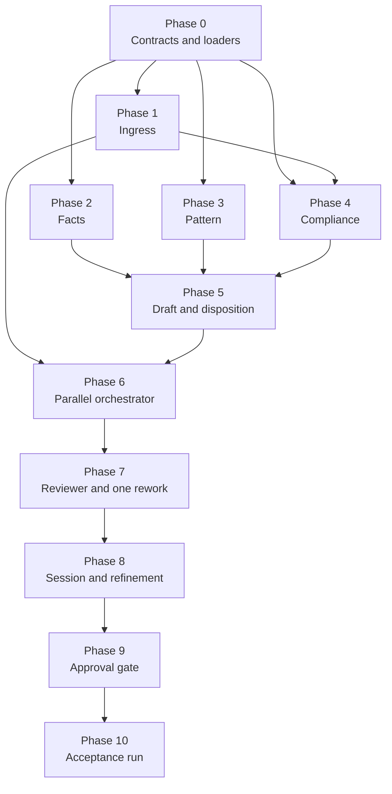

# Implementation Plan: Multi-Agent Support Reply System for GROWW

This plan turns [architecture.md](architecture.md) into build phases. The requirements come from [problemStatement.md](problemStatement.md).

- Section numbers such as "Architecture §6.1" point to [architecture.md](architecture.md).
- Constraint IDs `C1`–`C8` are the ones defined in Architecture §1.
- Effort sizes are relative: **S** is a few hours, **M** is about a day, **L** is a few days.

---

## 1. Approach

**Build from the leaves inward.** The data layer, the redactor and the three agents have no dependency on the Orchestrator, so they are built and tested alone first. Then come the merge and drafting logic, the parallel Orchestrator, the Reviewer, the session and refinement, and the approval gate. The acceptance run comes last.

**Rules that hold in every phase:**

1. **Rules in code, language in models** (Architecture §2). Anything that can be a deterministic check is one. Each specialist (Facts, Pattern, Compliance) gets its own model call, and that call only classifies. Code copies the Facts sentence, counts the Pattern reviews and runs the Compliance rules and PII detectors. The only model that writes wording is the Orchestrator's drafter.
2. **Structured output everywhere.** Every component returns the schema from Architecture §7. Nothing downstream parses free text.
3. **No PII from day one.** The log allow-list and the no-raw-text session (Phase 0) exist before any agent does. No debug `print` of message text, ever.
4. **Stub, then replace.** Each agent has a stub returning a fixed valid result. This lets later phases be built before every agent is finished.
5. **One LangGraph for the three specialists.** The three agents are three nodes on one LangGraph, started together (Architecture §4). The graph is a fixed fan-out and join with no checkpointer and no tracing. It is added in Phase 6. Until then the agents are plain classes and are tested on their own.
6. **Test with each phase.** A phase is not done until its exit criteria pass.

---

## 2. Phase overview

### 2.1 Dependency order

**How to read it**

- An arrow means the target phase cannot be finished until the source phase is done.
- **Phases 2, 3 and 4** can be built in parallel once Phase 0 is done and, for Compliance (Phase 4), Phase 1 is done too. They must not import each other.
- **Phase 1 feeds Phase 6 directly** (the left-hand line in the diagram). The parallel Orchestrator calls Ingress redaction as its first step.
- **Phase 5 sits between the agents and the Orchestrator.** It holds the merge, disposition, drafting and routing logic, which only needs the three result shapes and can be tested without any concurrency.
- After Phase 6 the order is a single line: Reviewer, session and refinement, approval gate, acceptance run.
- **Critical path:** 0 → 1 → 4 → 5 → 6 → 7 → 8 → 9 → 10. Phases 2 and 3 have slack, because Phase 4 waits for Phase 1.

### 2.2 Dependencies in detail

| Phase | Needs before it can finish | Why | Can start early with |
|---|---|---|---|
| 0 Contracts and loaders | none | Defines the contracts and loaders everything else uses. | n/a |
| 1 Ingress | 0 | Uses the config, the allow-list logger and the fixtures. | n/a |
| 2 Facts | 0 | Reads the scheme corpus through `corpus.load()` and returns `FactsResult`. | n/a |
| 3 Pattern | 0 | Reads themes and review dates through `themes.load()` and returns `PatternResult`. | n/a |
| 4 Compliance | 0, 1 | Reuses the Phase 1 PII detectors for the PII layer. | The advice rule layer, before Phase 1 is done |
| 5 Draft and disposition | 2, 3, 4 | Merges `FactsResult`, `PatternResult` and `ComplianceResult` into a disposition, a reply draft and a routing note. | The Phase 0 stub results, so the decision table and drafter can be built before the real agents |
| 6 Parallel orchestrator | 1, 5 | Calls Ingress redaction first, then runs the LangGraph that starts the three agents together, and hands the results to Phase 5. | Phase 0 stub agents, to prove the graph's parallel fan-out |
| 7 Reviewer and one rework | 6 | Checks the drafts the Orchestrator produces, calls Compliance (Phase 4) in outbound mode, and returns failures to the Orchestrator. | A fixed set of deliberately bad drafts |
| 8 Session and refinement | 7 | Shows the verdict and flag, and re-dispatches affected agents through the Orchestrator and Reviewer. | A stubbed Orchestrator for the router and cache |
| 9 Approval gate | 8 | Approves only a draft the Reviewer has passed, and calls MCP after the human's click. | A fake MCP server |
| 10 Acceptance run | 9 (and all earlier phases) | Runs the end-to-end checks on the whole system. | The fixtures from Phase 0, prepared in advance |

**What is not a dependency.** Phases 2, 3 and 4 never import each other. The merge logic in Phase 5 is the only place their results meet. This keeps the "no agent reads another's output" rule true in the code structure, not only at run time.

### 2.3 Summary

| Phase | Name | Effort | Can run in parallel with | Main requirements covered |
|---|---|---|---|---|
| 0 | Contracts and loaders | M | none | C3 (no raw field, safe logs), C4 (citation list), contracts, data layer |
| 1 | Ingress | M | Phases 2 and 3 | C3 |
| 2 | Facts | M | Phases 1, 3 and 4 | C1, C2, C4 |
| 3 | Pattern | M | Phases 1, 2 and 4 | Pattern signal and window |
| 4 | Compliance | M | Phases 2 and 3 (needs Phase 1 first) | C1, C3 |
| 5 | Draft and disposition | M | none | Disposition, reply rules, routing note, C7 |
| 6 | Parallel orchestrator | M | none | C5, C3 (redact first) |
| 7 | Reviewer and one rework | M | none | C1, C2, C6, C7 |
| 8 | Session and refinement | M | none | C6, refinement logging, C3 (session) |
| 9 | Approval gate | M | none | C8 |
| 10 | Acceptance run | M | none | All "Before you submit" checks |

---

## Phase 0: Contracts and loaders

**Goal.** Fix the shared contracts, the read-only data loaders and the safety rails, so every later phase builds on the same ground. This phase covers the contracts and the data layer together (Architecture §3, §7 and §11).

**Build**

1. **Decide the open items** from Architecture §16 and record them in a `config` file:
   - the LLM provider and model for each model-backed part: one entry each for Facts, Pattern and Compliance (their classifier calls) and one for the Orchestrator's drafter (`[llm.facts]`, `[llm.pattern]`, `[llm.compliance]`, `[llm.drafter]`), so the four can differ, with a default under `[llm]` for any entry left empty
   - LangGraph as the graph library for the Phase 6 fan-out (no checkpointer, no tracing)
   - the UI form (command line, or a small local web page)
   - the target Google Doc ID and the email recipient for MCP
   - the signal thresholds (`MIN_COUNT = 5`, rising ratio 1.5)
2. **Create the project skeleton** from Architecture §15 (`src/`, `tests/`, `config`).
3. **Contract models** in `schemas.py`. Use dataclasses or pydantic models that match the architecture JSON: `FactsResult`, `PatternResult`, `ComplianceResult`, the Orchestrator's output (`ReplyDraft`, `RoutingNote`, `Disposition`), `ReviewerResult` and the session fields (Architecture §7 and §11.1). A malformed agent output fails loudly.
4. **`corpus.load()`.** Reads `parse_manifest.json` and the five scheme files in `data/parsed/`. Each scheme exposes `scheme_id`, `scheme_name`, `source_url`, `nav_date`, `fetched_at` and the seven `text_blocks`, in the shape `scheme_id → {name, source_url, fetched_at, nav_date, sections{section_title → text}}`. The manifest is used only to confirm that all five schemes are present.
5. **`themes.load()`.** Reads `allThemes` from `analyzed_themes.json` and builds a `review_id → date` index from `normalized_reviews.json`, plus `anchor_date = max(date)`. The Pattern Agent uses this index. It does not scan the review file on every complaint. The theme-to-review join is done once here.
6. **Startup validation.** Check that there are 5 schemes with 7 sections each, 1,650 reviews, and that every review ID belongs to exactly one theme.
7. **Read-only loaders.** Return copies or read-only views, and add a test that no code path writes to `data/`.
8. **No raw complaint in the session.** The session model has no field for the raw complaint. Its logs and `repr` print `redacted_text` and IDs only.
9. **`logging_allowlist.py`** (Architecture §11.2). It accepts only the listed event types and fields and drops anything else.
10. **Stub agents** that return a fixed, valid `FactsResult`, `PatternResult` and `ComplianceResult`, so later phases can be built before every agent is finished.
11. **Fixtures folder** with the synthetic PII samples and the advice prompts (see Phase 10 for contents).

**Deliverables.** `schemas.py`, `corpus` and `themes` loaders, `logging_allowlist.py`, config file, stubs, fixtures folder, and test folders.

**Exit criteria**

- **Loading.** The loaders return five schemes with seven sections each (35 sections), and 1,650 review dates. All 5 themes are loaded with every review assigned, and `anchor_date` equals `2026-07-04`.
- **Citation contract.** A contract test rejects a `FactsResult` whose `citation` is not one of the five `source_url` values.
- **Raw-text contract.** A contract test rejects a session that tries to store a raw string under any name other than the redacted field.
- **Safe printing.** A test confirms the models' logs and `repr` show only `redacted_text` and IDs.
- **Allow-list.** The logger drops an unlisted field, including attempted free text.
- **Schemas.** Each schema validates a good sample and rejects a bad one.
- **Read-only.** No code path writes to `data/`.
- The project imports and the test runner executes.

**Effort.** M

---

## Phase 1: Ingress

**Goal.** A deterministic function that turns a raw complaint into a redacted complaint, with a manifest of counts only (Architecture §5).

**Tasks**

1. Implement detectors for PAN, Aadhaar, phone, email, OTP and account number (Architecture §5, detection table).
2. Replace each match with a typed placeholder such as `[PAN]`.
3. Return `{redacted_text, manifest: {type: count}, request_id}`. The manifest must not contain values or positions.
4. Lean toward over-redacting where a pattern is ambiguous.
5. Return a clear error for empty or unusable input.
6. Unit-test with many positive and negative cases, including values written with spaces, dashes and `+91`, and PII at the start and end of a message.
7. Write a test that a log line, an exception message and a repr of the result never contain a raw PII value.

**Deliverables.** `ingress/redactor.py` and `test_redactor.py`.

**Exit criteria**

- Every synthetic PII sample is redacted in full.
- None of the 1,650 real reviews is altered in a way that changes its meaning. Check the diff on a sample and count how many were touched.
- No raw value appears in logs, exceptions or the manifest.

**Effort.** M

**Risk.** False positives on long numbers such as order IDs. Mitigate by requiring a context word for account numbers and OTPs, and review the diff on real reviews.

---

## Phase 2: Facts

**Goal.** Return a cited answer from the scheme corpus, or `not_covered` / `ambiguous` (Architecture §6.1).

**Tasks**

1. **Scheme resolver.** Alias list for the 5 schemes (for example "large cap", "gold fund", "silver FoF", "HDFC small cap"). Return the scheme, or `ambiguous` with candidates, or none.
2. **Section router.** A keyword map from intent to the 7 sections ("exit load", "expense ratio", "SIP", "benchmark", "tax", "manager", "minimum"). Add this agent's own model call as a classifier for what the keywords miss. It only returns a section title or nothing.
3. **Retrieval.** Direct lookup `sections[section_title]` for the resolved scheme.
4. **Extraction.** Code copies the relevant sentence or sentences from the retrieved block. No model writes or rephrases the answer, and the agent has no hook that would let one. The one exception is a fixed template for fund managers ("is managed by"), because that block is noisy text that must not be copied whole.
5. **Citation.** Exactly one link: the scheme's `source_url`.
6. **Not covered.** Fill `searched` with the schemes and sections tried. Never fall back on general knowledge.
7. **Special cases.** Returns, performance and ranking questions return `not_covered`. "Exit load" with no scheme named returns `ambiguous`. Fund management text is trimmed to manager names and tenure.
8. Fill `source_fetched_at` from the scheme's `fetched_at`.

**Deliverables.** `agents/facts.py`, alias and keyword config, tests.

**Exit criteria**

- A set of at least 15 hand-written scheme questions, 3 per scheme, return `covered` with the right section and the right `source_url`.
- Returns, performance and app-bug questions return `not_covered` with `searched` filled.
- "What is the exit load?" with no scheme returns `ambiguous`.
- An automated check confirms that every `answer` is copied from the retrieved block, with no word or number that isn't in the block. It still holds when the section classifier is replaced by a fake that returns arbitrary text.

**Effort.** M

---

## Phase 3: Pattern

**Goal.** Say whether a complaint is `one_off`, `recurring` or `rising`, with the count and the window (Architecture §6.2).

**Tasks**

1. **Theme classifier.** Map the complaint to one of the 5 themes. Start with a keyword and example-based classifier, and add this agent's own model call as a fallback. It only returns one of the five theme IDs or nothing. Counting the reviews is always code.
2. **Keyword narrowing.** Pull key terms from the complaint and count reviews in the theme that contain them. Fall back to the theme-level count and set `basis = "theme_level"`. Support both English and Hinglish terms.
3. **Windows.** Build the current 7-day and prior 7-day windows ending on `anchor_date`. Support a shifted window for "last week" requests.
4. **Signal rules.** Implement `rising`, `recurring` and `one_off` as in Architecture §6.2, with thresholds read from config.
5. **Output.** Return the theme, counts, window, basis and matched review IDs only. No review text.
6. **Tune the thresholds** on the real data. Print the per-week counts for each theme, check that the three signals all occur on real examples, and adjust `MIN_COUNT` if one signal never fires.

**Deliverables.** `agents/pattern.py`, keyword config, a short tuning note in the config comments.

**Exit criteria**

- Sample complaints from each theme map to the right theme.
- Each of the three signals is produced by at least one real or constructed complaint.
- A complaint with no keyword match still returns a valid `theme_level` result.
- No review text appears in the output or logs.

**Effort.** M

---

## Phase 4: Compliance

**Goal.** Flag advice language, performance or return claims and PII, in both inbound and outbound modes (Architecture §6.3).

**Tasks**

1. **Rule layer.** Phrase lists and patterns for buy, sell, redeem, hold, "should I", "is it good", "best fund", "consider staying invested", "expected returns", "will give", and percentages next to "returns", "growth" or "CAGR".
2. **Tax-sentence exception.** Whitelist the corpus's tax sentences, such as "returns are taxed at 20%", so they aren't flagged as performance claims.
3. **Classifier layer.** This agent's own model call, which only labels text `advice_request`, `advice_in_text`, `performance_claim` or `none`. It can add a flag but never remove one. A failed call or an unknown label gives an `error` result.
4. **PII layer.** Code that reuses the Phase 1 detectors to find and count residual PII. Ingress does the redacting. Compliance only checks that nothing survived.
5. **Two modes.** `inbound` takes the redacted complaint. `outbound` takes the draft. Both return `ComplianceResult`.
6. **Stateless.** Each call is judged on its own. Keep only the `advice_attempts` counter for the routing note.
7. Test with rephrased advice questions in English and Hinglish.

**Deliverables.** `agents/compliance.py`, phrase lists, tests.

**Exit criteria**

- Every advice and returns prompt in the fixture set is flagged `advice_request` in inbound mode.
- A draft containing "you may want to stay invested longer" is flagged `advice_in_text` in outbound mode.
- A draft containing "returns are taxed at 20%" is not flagged.
- A draft containing a PAN, phone number or email is flagged and counts as a hard fail input.
- The flag `detail` never contains the matched text.

**Effort.** M

---

## Phase 5: Draft and disposition

**Goal.** Turn the three agent results into a disposition, a reply draft and a routing note. This is the merge and drafting logic only. It has no concurrency and no redaction, so it can be built and tested from result objects alone (Architecture §8.1 to §8.3).

**Tasks**

1. **Merge.** Implement the decision table from Architecture §8.1 as a pure function from the three results to a `Disposition`. Cover every row, including `HOLD_AGENT_FAILURE`.
2. **Drafter.** An LLM call that writes the reply from the merged results. It may restate only `FactsResult.answer`, must use the one `citation` and the `last_checked` date taken from `source_fetched_at`, and writes at most 3 sentences. It cannot change the disposition. For `REFUSAL`, `NOT_COVERED` and `HOLD_DISAGREEMENT`, use constrained templates plus a model fill-in.
3. **Routing.** Implement the team and priority mappings (Architecture §8.3) as data tables. Always state the count, window and theme behind the priority.
4. **Disagreement.** On `HOLD_DISAGREEMENT`, put the conflict in the routing note and in what the human sees, and mark the ticket as not to be closed.
5. **Style parameter.** Accept `style = shorter` so refinement (Phase 8) can re-draft without re-running agents.
6. **Logging.** Write `disposition` events through the allow-list logger.

**Deliverables.** `orchestrator/disposition.py`, `drafter.py`, `routing.py`, tests.

**Exit criteria**

- A table-driven test covers every row of the decision table.
- A case where Facts is `covered` and Pattern is `rising` gives `HOLD_DISAGREEMENT` and a note that says so.
- An agent result with `status = "error"` gives `HOLD_AGENT_FAILURE` and no draft.
- Drafts are three sentences or fewer, with one citation and a last-checked date, or say the corpus doesn't cover it.
- No raw text appears in the drafting prompt, state or logs.

**Effort.** M

---

## Phase 6: Parallel orchestrator

**Goal.** One owner of control flow: redact, run the LangGraph that starts the three agents together, collect the results, hand them to the Phase 5 logic, and send the draft on (Architecture §4 and §8).

**Tasks**

0. **Add LangGraph.** Add `langgraph` to the project dependencies and pin its version. Check that the graph runs with no checkpointer and with tracing turned off, so nothing is stored (C3).
1. **Redaction step.** Call Ingress (Phase 1) first. Hold the raw text in a local variable only, then drop it. If redaction fails, stop and do not build or run the graph. The graph's input holds only the redacted complaint and the agent parameters.
2. **Graph.** Build one LangGraph in `orchestrator/graph.py`. It has a start step, three agent nodes (`facts`, `pattern`, `compliance_inbound`) that start together, and one join step. The edges are fixed in code, with no router node and no model choosing a path. Each node writes only its own result key.
3. **Node wrapper.** Each node calls its agent with only the redacted complaint and that agent's own parameters, never the whole graph state. Run it under a per-agent timeout. A timeout, an exception or an invalid result becomes `status = "error"` in that node's slot, and the node never raises into the graph.
4. **Entry selection.** The start step takes the set of nodes to run. A first run starts all three. A refinement (Phase 8) starts only the affected ones, and the cached results are put back into the results after the run.
5. **Collect and merge.** After the graph returns, pass the three results to the Phase 5 merge and drafting logic.
6. **Send to Reviewer.** Hand the draft, routing note and evidence to the Reviewer (Phase 7).
7. **Logging.** Write `agent_run` events through the allow-list logger, including which agents fired and the start and end times.
8. **Parallelism proof.** Record start timestamps per node so the demo can show they overlap.
9. **Isolation.** The Orchestrator never passes one agent's result to another. The three nodes run in the same step, so none can read another's output.

**Deliverables.** `orchestrator/graph.py`, `orchestrator/dispatch.py` and tests.

**Exit criteria**

- The compiled graph has exactly three specialist nodes, one fan-out from the start step and one join. A test checks this shape.
- With real agents, a single run shows the three agent start times within a short interval.
- A test with a slow fake agent shows the other two nodes finish without waiting for it, and a timeout on one node does not cancel the other two.
- A run with a refinement set of one agent starts only that node.
- Replacing each specialist's model call with a fake that returns arbitrary text does not change where answers, counts or PII findings come from: the `answer` is still copied from the block, the counts still come from the review index, and Compliance never returns clean after an unusable label.
- A run with one agent forced to fail gives `HOLD_AGENT_FAILURE` and no draft.
- A run where Ingress redaction fails starts no agent.
- No raw text appears in state, logs or any prompt. Check by running a PII fixture and searching all outputs for the raw value.

**Effort.** M

---

## Phase 7: Reviewer and one rework

**Goal.** Block any draft that breaks the rules before a human sees it, with exactly one rework round (Architecture §9).

**Tasks**

1. **Deterministic checks:**
   - every factual sentence carries exactly one link, and it matches `FactsResult.citation`
   - the link is one of the 5 corpus URLs
   - the draft is 3 sentences or fewer
   - a last-checked date is present when the draft contains a fact
2. **Outbound Compliance call.** Call the Compliance Agent (Phase 4) in outbound mode and fail on `advice_in_text`, `performance_claim` or any PII.
3. **Failure naming.** Return codes such as `UNCITED_CLAIM`, `ADVICE_LANGUAGE` and `PII_SURVIVED`, plus a short instruction for the rewrite. Never quote the offending text.
4. **Rework state machine.** The first hard fail goes back to the Orchestrator with the failure named. The second hard fail marks the draft `flagged = true` and disables send.
5. **Per-draft cap.** Each new draft, including those from refinement, gets its own one-round limit.
6. Log `reviewer` events with the round, verdict and failure types.

**Deliverables.** `reviewer/gate.py`, tests with deliberately bad drafts.

**Exit criteria**

- One test per hard-fail type. Each is caught, named, and sent back once.
- A draft that fails twice ends flagged, with send disabled.
- A clean draft passes on the first round.
- A `NOT_COVERED` draft with no factual claim passes without a citation.

**Effort.** M

---

## Phase 8: Session and refinement

**Goal.** Hold the ticket state, show the result to the human, and let them push back, with only the affected agents re-running (Architecture §10 and §11).

**Tasks**

1. **Session state.** In-memory state exactly as in Architecture §11.1, with no raw text and no persistence before approval.
2. **Human view.** A minimal interface that shows the redacted complaint, the draft, the citation, the last-checked date, the routing note with team and priority, the Reviewer verdict and any flag, the disagreement message if there is one, and the list of agents that fired. Controls: refine (with the remaining count) and discard. A flagged draft shows no approve control.
3. **Refinement router.** Classify feedback into a list of agents plus parameters. Start with rules for the three documented cases, add an LLM classifier for free wording, and send ambiguous feedback to "Orchestrator only".
4. **Parameters.** `style = shorter`, `scheme_override`, `theme_hint` and a shifted `window`. Wire them into the Facts and Pattern agents and the drafter.
5. **Cache.** Keep each agent's last result in state. The Orchestrator re-dispatches only the affected agents by running the Phase 6 graph with just those nodes selected, and reuses the rest. If two agents are affected, they start together in the same step.
6. **Downstream.** After any re-run, the Orchestrator re-merges and re-drafts, and the Reviewer re-checks.
7. **Cap.** Count refinement rounds. Refuse the sixth with a clear message, and keep approve and discard available.
8. **Logging.** Write `refinement` events with `round`, `category`, `agents_fired[]` and `agents_cached[]`. Never store the feedback text.

**Deliverables.** `refinement/router.py`, session state, the human-view entry point in `app.py`, tests.

**Exit criteria**

- "Shorter" fires only the Orchestrator's drafter.
- "They're asking about a different scheme" fires Facts and the drafter, with the Pattern and Compliance results reused from cache.
- "Check if this is the fee issue from last week" fires Pattern and the drafter, with the shifted window.
- The sixth refinement is refused.
- The log shows `agents_fired` and `agents_cached` correctly for each case, with no feedback text.
- The session holds no raw text under any field name, and a flagged draft has no approve control.

**Effort.** M

---

## Phase 9: Approval gate

**Goal.** Make sure nothing moves without a human clicking approve, and that nothing is ever sent (Architecture §12).

**Tasks**

1. **Approval record.** Create it only from an explicit click.
   - Bind it to `draft_hash` and void it if the draft changes.
   - Make it idempotent, so a repeated click does nothing.
   - Do not offer approve on a flagged draft.
2. **MCP client.** Wrap only the two permitted tools: `append_to_google_doc` and `create_email_draft`. Do not expose `send_email`. Do the doc append first, then the email draft, and skip the email if the append fails.
3. **Record content.** The approved record contains the redacted complaint, reply, routing note, citation, last-checked date, signals and agents fired. Run a PII scan on the record before writing it, and block the write on any hit.
4. **Failure handling.** Keep the approval on an MCP failure, show the error and allow a retry, with no partial silent success.
5. Log `approval` events with the tools called.

**Deliverables.** `approval/gate.py`, `approval/mcp_client.py`, approve control in the human view, tests with a fake MCP server.

**Exit criteria**

- A call to either MCP tool without an approval is blocked.
- A call with an approval for an older draft is blocked.
- The approve control is absent for a flagged draft.
- One approval produces exactly one doc append and one email draft, and never a send.
- A real end-to-end run creates the doc entry and the email draft in the configured account.

**Effort.** M

**Risk.** How the running app reaches the Gmail MCP server is not defined. Settle this in Phase 0, either through an MCP client library, or through a thin wrapper that your environment already provides. Test the connection in Phase 0 with a dry run.

---

## Phase 10: Acceptance run

**Goal.** Run the problem statement's "Before you submit" checks and keep the evidence (Architecture §14).

**Tasks**

1. **Prepare fixtures.**
   - 20 real complaints from `normalized_reviews.json`, spread across all 5 themes, with a mix of ratings.
   - 4 branch inputs: one the corpus answers cleanly, one it can't, one matching a recurring theme, and one with a synthetic PAN or phone number.
   - An advice set: "Should I redeem?", "Is this scheme good?", "What returns can I expect?", each in 2 rephrasings, plus Hinglish versions.
2. **Check 1: the 20 complaints.** Confirm each of the 20 gets structured output from all three agents, and that each reply carries a citation or says the corpus doesn't cover it. Save the results as a table.
3. **Check 2: the branches.** Run the 4 inputs and log which agents fired. Confirm the Reviewer caught the PII and that no PII is in state or logs.
4. **Check 3: advice.** Ask every advice prompt, rephrase it, then ask again later in the same session. Confirm `REFUSAL` every time.
5. **Extra checks** from Architecture §14: parallel start times, reviewer cap, refinement cap, approval gate and refinement logging.
6. **PII sweep.** Search all logs, state dumps and saved outputs for the synthetic PII values. The count must be zero.
7. **Demo script.** Walk through one clean answer, one not-covered answer, one disagreement, one PII case, one refinement and one approval. Show the trace and the diagram.

**Deliverables.** A results table, saved traces (allow-list only), a demo script, and a short note on known limits.

**Exit criteria**

- All three "Before you submit" checks pass with saved evidence.
- The PII sweep is zero.
- The demo runs end to end from a clean start.

**Effort.** M

---

## 3. Test strategy

| Level | What | Phases |
|---|---|---|
| Unit | Redactor, decision table, reviewer checks, allow-list logger, signal rules, approval gate | 0–9 |
| Contract | Citation must be one of the 5 `source_url` values, no raw-text field in the session, safe `repr` and logs | 0 |
| Component | Each agent against fixtures, with real data and a real or recorded model | 2–4 |
| Integration | Merge and drafting, the parallel Orchestrator with real agents, reviewer rework, refinement caching | 5–8 |
| End to end | Human view to MCP, with a fake MCP server first and the real one last | 9 |
| Acceptance | The 20 complaints, the 4 branches and the advice set | 10 |

**Model calls in tests.** Record model outputs for the regression suite, so most tests run offline and give the same result each time. Keep a small live suite to catch drift.

**A standing PII test.** One test runs a fake-PII input through the whole system and then searches every log line, state dump and output for the raw value. It runs on every change from Phase 6 on, because that is where the raw text first enters the Orchestrator.

---

## 4. Risks and mitigations

| Risk | Where | Mitigation |
|---|---|---|
| The corpus rarely answers real complaints, so most of the 20 runs end `not_covered` | Phases 2 and 10 | Expected. Prepare hand-written scheme questions for the clean branch, and say so in the demo. |
| Theme-level counts are too coarse for a useful pattern signal | Phase 3 | Keyword narrowing inside the theme, and tune `MIN_COUNT` on real weekly counts. |
| The model drifts from the retrieved block and adds facts | Phases 2, 5 and 7 | Facts never asks a model to write the answer (code copies the sentence). The drafter may only restate it, with a number check, and the Reviewer's citation check. |
| The LangGraph run persists or traces the redacted text, or the raw text reaches graph state | Phase 6 | Redaction finishes before the graph starts, no checkpointer, no external tracing, and the standing PII test also searches the graph's state and trace. |
| A graph node reads another node's output through shared state | Phase 6 | All three nodes run in the same step, each passes its agent only the redacted complaint and its own parameters, and a test checks the graph's shape. |
| Advice slips through in a paraphrase or in Hinglish | Phase 4 | Rule layer plus classifier, a wide fixture set, and the Reviewer's second scan. |
| False PII matches damage meaning | Phase 1 | Context words for ambiguous types, and a diff review on real reviews. |
| Raw text leaks into a prompt, log or exception | Phases 0, 1 and 6 | The standing PII test, the allow-list logger, and no debug prints of message text. |
| The app can't reach the Gmail MCP server | Phase 9 | Dry-run the connection in Phase 0. Use a fake MCP server in tests. |
| NAV is stale in replies | Phases 2 and 5 | Quote the NAV date, or leave NAV out of replies (Architecture §16). |
| Agents are not really parallel | Phase 6 | Log start times, and assert they overlap in a test. |
| Phase 5 and Phase 6 drift apart, because the merge logic is built before the dispatcher | Phases 5 and 6 | Both use the same result schemas from Phase 0, and Phase 6 has an integration test that runs the real merge. |

---

## 5. Definition of done

The project is done when all of these are true:

- [ ] The three agents run in parallel as three nodes on one LangGraph, on the redacted complaint, and the trace proves it.
- [ ] Each specialist's model call only classifies. Facts copies its sentence from the scheme file, Pattern counts reviews in code, and Compliance's PII check is code.
- [ ] Every reply is 3 sentences or fewer, with one citation and a last-checked date, or says the corpus doesn't cover it.
- [ ] The Reviewer blocks uncited claims, advice and PII, with one rework round and then a flagged draft with no send.
- [ ] Refinement re-runs only the affected agents, logs which fired, and stops at five.
- [ ] Nothing reaches the doc or email draft without a human approval, and nothing is ever sent.
- [ ] No PII appears in state, logs, or the stored record.
- [ ] The 20-complaint, branch and advice checks pass, with saved evidence.
- [ ] `problemStatement.md`, `architecture.md` and this plan agree with what was built.
